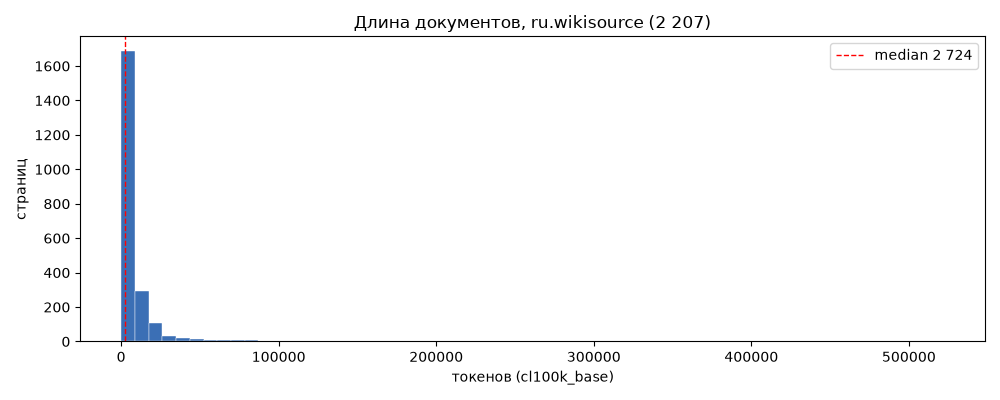

# КТ1. Корпус, EDA, золотой набор

## 1. Корпус

- **Источник**: ru.wikisource.org, категории «Кодексы РФ», «Федеральные законы»,
  «Фед. конст. законы», «Конституция РФ» (последняя дала 0 страниц — категория
  пустая): 2 043 страницы кодексов (41 кодекс, включая главы и исторические
  редакции), 161 ФЗ, 2 страницы Конституции, 1 закон РСФСР.
- **Сбор**: полный дамп `ruwikisource-articles.xml.bz2` (API отдаёт 429 на ~10
  запросов; дамп — 1 источник, все страницы, включая 522k-токеновые главы НК РФ,
  которые через API не получить). `src/corpus/fetch.py` парсит дамп по
  `[[Категория:…]]`.
- **Выход**: 2 345 страниц → **2 207** (113 не-русс.) → **1 404** после дедупликации
  (КТ2). Токенов (cl100k_base): **17 488 743**.

## 2. EDA (`src/corpus/eda.py`, до чистки)

| Показатель | Значение |
|---|---|
| страниц / токенов | 2 207 / 17 488 743 |
| длина: среднее / медиана / p99 / max | 7 924 / 2 724 / 71 519 / 522 205 (НК РФ, гл. 25) |
| < 50 токенов | 0 (минимум — 119) |
| > 2 000 токенов | 1 247 (56%) |
| мусорные токены | 0.5% (вики-разметка, ссылки, шаблоны) |
| дубли | точных 23% / near 42% (MinHash, jaccard > 0.8) |

Распределение длин (`reports/kt1/lengths_hist.png`):

**Ответы на вопросы ТЗ** (показатели — в таблице):

1. **Типовой размер**: медианная страница 2 724 токена (глава кодекса); распределение
   с тяжёлым хвостом — 3 страницы (гл. 21/22/25 НК РФ, 1.06M токенов = 6% корпуса)
   требуют стратегии, устойчивой к длине (фиксированный token-чанк; семантические/
   нейронные — стоимость растёт линейно, подтверждено в КТ2).
2. **Шум**: 0.5% токенов — чистая разметка (мало: legal wikitext — текст, не HTML);
   дубли (23%/42%) — основной шум, убирается дедупликацией.
3. **Тематические кластеры**: 10 кодексов (ГК, УК, НК, ТК, ГПК, АПК, КоАП, СК,
   ЖК, ВАС) + законы (о полиции, о госслужбе, об образовании, об НКО, о
   самозащитных организациях) + Конституция; внутри кодексов — главы.
4. **Проблемы для чанкинга**: (а) одна «страница» = глава на сотни статей —
   «документ» как единица релевантности крупнее ответа; (б) тяжёлый хвост длин
   (до 522k токенов); (в) в wikitext **нет заголовков статей** — граница «статьи»
   видна только по тексту («Статья 123.»). **Для ретрива**: (г) юридическая
   канцелярит-синонимия («вступил в силу» = «принят» = «опубликован») — BM25-у
   не по зубам, нужны dense; (д) дубли → выдача засорена копиями.

## 3. Золотой набор (60 вопросов)

- **Состав**: factual 24 (40%), composite 13 (22%), abstract 13 (22%), negative 10
  (17%). Отклонение от ТЗ 30/30/20/20: composite/abstract по определению опираются
  на конкретные данные (даты, суммы, составы списков) — в корпусе их мало; факты
  (номера статей, размеры штрафов, компетенции) — много. Покрытие: 24 документа
  (14 ФЗ, главы кодексов, Конституция) из 2 207. Для 60 вопросов достаточно: каждый тип
  проверяет свой навык ретрива, а не breadth по корпусу.
- **Split**: validation 42 (f 17, c 9, a 9, n 7) / test 18 (f 7, c 4, a 4, n 3) —
  стратифицированный, `seed=42`.
- **Генерация**: LLM (Qwen3.8-27B-NVFP4, `temperature=0`) по случайным 1 500-символьным
  окнам корпуса; ответ — `answer_context`, который **должен быть дословной
  подстрокой** документа (≤ 250 символов). Промпты: `src/gold/generate.py`
  (P_FACT / P_ABSTRACT / P_COMP / P_NEG).
- **Верификация** (`src/gold/verify.py`): дословность (подстрока после нормализации
  вики-ссылок), существование doc_id; для negative — ни одно отличительное слово
  вопроса не встречается в корпусе **и номер закона из вопроса не существует в
  корпусе** (иначе negative ложный — ответ в корпусе). **221 кандидат → 139
  отклонено (63%)** → 82 прошли → финальная выборка 60. Типичные причины отказа:
  ответ сшит из несмежных мест / модель перефразировала (f, a); в ответе скопирована
  вики-разметка (c); слово вопроса нашлось в корпусе (n). После сборки вручную
  отловлены 3 ложных negative (закон из вопроса оказался в корпусе: 129-ФЗ, 38-ФЗ
  «О рекламе» в виде поправок, 32-ФЗ «О занятости») — заменены вопросами о законах,
  которых в корпусе нет (почтовая связь, видеопрограммы/базы данных, судорегистр).
- **Лексическое разнообразие**: вопросы сгенерированы моделью — опечаток нет;
  разнообразие умеренное (канцелярит-стиль повторяется), что для юридического
  корпуса естественное (запросы пользователей будут в том же регистре).
- **Токены**: 12 159 в 60 вопросах, ~203/вопрос.

### 3.1 Baseline: модель без RAG (validation, 42 вопроса)

`src/evals/baseline.py`: «Ответь только по своим знаниям. Если не знаешь — «не знаю».
Ответ в одной строке». LLM: Qwen3.8-27B-NVFP4, `temperature=0`.

| тип | «не знаю» из |
|---|---|
| фактические | 9/17 |
| составные | 2/9 |
| абстрактные | 3/9 |
| negative | **0/7** |
| всего | 14/42 |

(критерий: ответ начинается с «не знаю»; частичные отказы «не знаю X, но …» не учитываются)

- Negative-вопросы — о законах, **отсутствующих в корпусе** (проверено: ни слова
  вопроса, ни номер закона в корпусе не встречается). Модель без RAG не даёт чистого
  отказа (0/7 начинается с «не знаю»): на известные законы отвечает из
  параметрической памяти (знает 152-ФЗ, 135-ФЗ), на незнакомый («О почтовом
  сообщении») объясняет, что «закон не существует», а не отказывается.
  Значение негативов — в КТ5: RAG-система обязана ответить «не знаю», когда
  ответа нет в корпусе, даже если модель «знает» из памяти (grounding на
  retrieved-контекст); голый LLM вынудить на отказ нечем.
- Средний ответ: 27.3 c (локальная модель, batch 1); длина 10–1 191 символ.
- **Вывод**: RAG нужен и для фактов (модель не знает текущие редакции), и для
  негативов (заземление на корпус даёт сигнал «не в источнике»).

## 4. Артефакты

| Файл | Что |
|---|---|
| `data/corpus.jsonl` | корпус (2 207, 66 МБ) |
| `data/page_dates.json` | даты ревизий (2 345) |
| `data/gold/gold_full.json` | 60 вопросов (q, type, doc_ids, answer, split) |
| `data/gold/gold_val.json` / `gold_test.json` | split 42/18 |
| `data/gold/baseline_no_rag_val.json` | baseline на validation (42 ответа) |
